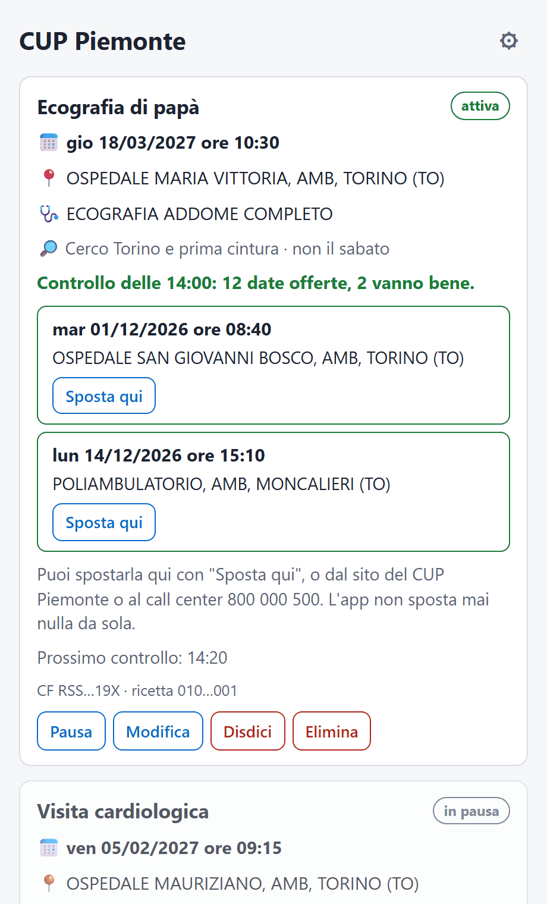
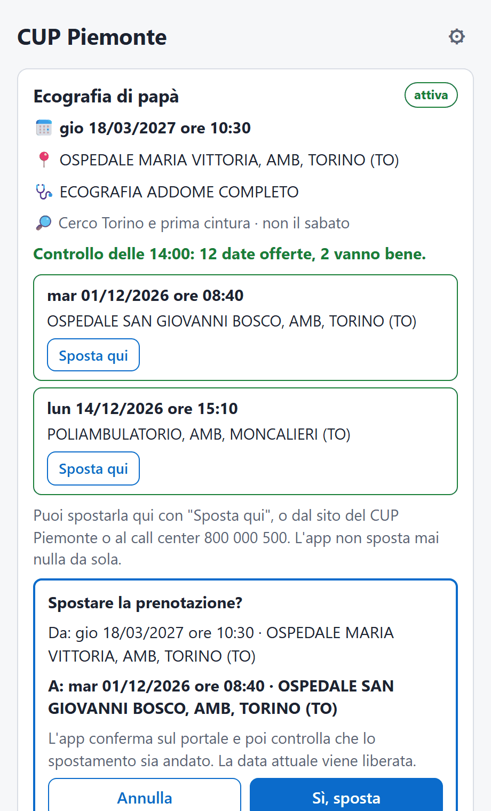
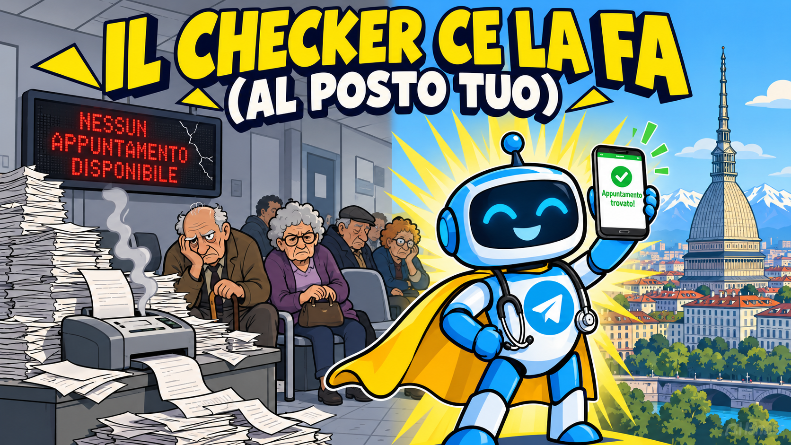

# CUP Piemonte: trova una data prima per la tua visita

[](https://github.com/ilmondovero/cup-piemonte-checker/releases)
[](https://github.com/ilmondovero/cup-piemonte-checker/actions/workflows/app-prove.yml)
[](https://ilmondovero.github.io/cup-piemonte-checker/)

Hai una visita prenotata sul [CUP Piemonte](https://cup.isan.csi.it/) tra mesi? Le date si liberano di
continuo, ma bisogna ricontrollare il portale a mano. L'app e il bot di questo repository lo fanno al
posto tuo e ti avvisano quando esce una data **prima** della tua prenotazione, con data, ora e luogo. Se
la ricetta non è ancora prenotata, cercano il primo posto libero.

Progetto indipendente e gratuito, **non ufficiale**: non è collegato alla Regione Piemonte né al CSI
Piemonte. Usa il portale pubblico come lo useresti tu dal browser.

## 📥 Scarica l'app

L'app per il computer è il modo più semplice: si installa, si aggiunge la ricetta e controlla da sola
ogni 20 minuti. Gratuita, senza account e senza server.

| Sistema | Download | |
|---|---|---|
| **Windows** 10 e 11 | [**Installer (.exe)**](https://github.com/ilmondovero/cup-piemonte-checker/releases/download/app-v0.1.0/CUP-Piemonte_0.1.0_x64-setup.exe) | consigliato · oppure [.msi](https://github.com/ilmondovero/cup-piemonte-checker/releases/download/app-v0.1.0/CUP-Piemonte_0.1.0_x64.msi) per tutti gli utenti |
| **macOS** (Intel e Apple Silicon) | [**Immagine disco (.dmg)**](https://github.com/ilmondovero/cup-piemonte-checker/releases/download/app-v0.1.0/CUP-Piemonte_0.1.0_universal.dmg) | trascina l'app in Applicazioni |
| **Linux** 64 bit (x86_64) | [**.deb**](https://github.com/ilmondovero/cup-piemonte-checker/releases/download/app-v0.1.0/CUP-Piemonte_0.1.0_amd64.deb) · [**.rpm**](https://github.com/ilmondovero/cup-piemonte-checker/releases/download/app-v0.1.0/CUP-Piemonte-0.1.0-1.x86_64.rpm) · [**.AppImage**](https://github.com/ilmondovero/cup-piemonte-checker/releases/download/app-v0.1.0/CUP-Piemonte_0.1.0_amd64.AppImage) | Ubuntu 22.04+, Debian 12+, Mint 21+ · Fedora e openSUSE · le altre |

Versione 0.1.0 (versione di prova). La [**pagina di download**](https://ilmondovero.github.io/cup-piemonte-checker/)
propone l'ultima versione per il tuo sistema; tutte le versioni e le somme SHA-256 sono nella
pagina [Releases](https://github.com/ilmondovero/cup-piemonte-checker/releases).

> **Al primo avvio** Windows e macOS avvisano, perché gli installer non sono firmati con un certificato.
> Windows: *Ulteriori informazioni* → *Esegui comunque*. macOS: *Impostazioni di Sistema* → *Privacy e
> sicurezza* → *Apri comunque*. I dettagli sono in [`app/README.md`](app/README.md#installarla).

<p align="center">
  
  &nbsp;&nbsp;
  
</p>

**Cosa fa l'app**
- Legge la tua prenotazione (codice fiscale e numero ricetta) e la controlla ogni 20 minuti, anche con
  la finestra chiusa: resta nella barra di sistema (su macOS nella barra dei menu). Il computer deve
  essere acceso e non in sospensione.
- Cerca dove vuoi tu: la stessa sede, il tuo comune o un altro, Torino e prima cintura, la provincia o
  dove propone il CUP. Puoi escludere dei giorni.
- Quando esce una data prima arriva una notifica con data, ora e luogo.
- **Non sposta mai nulla da sola.** "Sposta qui" mostra la data attuale e quella nuova e sposta solo
  dopo il tuo "Sì", poi controlla sul portale che sia andata. Puoi anche disdire.
- **Ricetta non ancora prenotata** (dalla versione 0.2.0): cerca il primo posto libero nella zona scelta e
  te lo propone; prenota solo con "Prenota qui" e il tuo "Sì", poi cerca date prima. È una funzione nuova:
  un passo del portale non è ancora stato visto con una ricetta vera, e se qualcosa non torna l'app si
  ferma senza prenotare.
- Più ricette, anche di familiari, ognuna con la sua zona.
- **I dati restano sul tuo computer**, cifrati: codice fiscale e ricetta vanno solo al portale CUP.
  L'app non manda niente a nessuno.

Come funziona dentro, limiti e privacy: [`app/README.md`](app/README.md). Disinstallazione, dove stanno i
dati e altre domande: nella [pagina di download](https://ilmondovero.github.io/cup-piemonte-checker/#domande).
Problemi: [Issues](https://github.com/ilmondovero/cup-piemonte-checker/issues/new/choose), senza mai
scrivere codice fiscale, ricetta o dati della visita.

## Quale scegliere

| | App per il computer | Bot Telegram | Script originale |
|---|---|---|---|
| Per chi | chiunque | chi ha un server e lo offre ad altri | chi ha Python sul PC |
| Dove gira | sul tuo computer | su un server (VPS) | sul tuo computer |
| Avvisi | notifiche del sistema | messaggi Telegram, anche sul telefono | messaggi Telegram |
| Visita già prenotata: cerca date prima | sì | sì | no |
| Sposta la prenotazione | sì, solo con il tuo "Sì" | sì, con un tocco (o in automatico, se lo attivi) | no |
| Ricetta mai prenotata | sì, cerca e prenota col tuo "Sì" (dalla 0.2.0, sperimentale) | sì, cerca e prenota (sperimentale) | sì, avvisa quando c'è posto |
| Installazione | un installer | server Linux, Docker o systemd | Python, Playwright, Chromium |
| Cartella | [`app/`](app/) | [`telegram-bot/`](telegram-bot/) | questa |

Sono tre progetti separati, senza codice in comune. Se segui la stessa ricetta con l'app e con il bot,
usane uno solo: ogni controllo tiene bloccata una data per circa 40 minuti.

## Bot Telegram senza browser (cartella [`telegram-bot/`](telegram-bot/))

Il bot controlla il portale al posto tuo. Ti avvisa quando si libera una data **prima** della tua
prenotazione e, se vuoi, la sposta per te. Con una ricetta **non ancora prenotata** cerca il primo
appuntamento libero (funzione sperimentale, vedi sotto).

- **Niente browser.** Parla con il portale via HTTP e replica le richieste che farebbe il browser. Il
  "controllo anti-bot" di cui parla lo script originale, verificato a settembre 2026, risulta
  disattivato: il reCAPTCHA viene caricato con chiave vuota e il form parte senza token.
- **Multiutente, tutto in chat.** Ognuno si registra con `/start`: informativa, codice fiscale e numero
  ricetta. Il bot verifica subito la prenotazione e mostra prestazione, data, ora e luogo.
- **Pulsante "Prenota".** Quando esce una data migliore arriva un messaggio con data, ora e luogo; un
  tocco sposta la prenotazione. Poi il bot verifica con una sessione nuova che lo spostamento sia
  avvenuto davvero.
- **Dove cercare.** Stessa sede, sedi scelte, un comune o più comuni (per esempio Torino e prima
  cintura), la provincia o ovunque proponga il CUP. Si possono escludere delle sedi. Per comune e
  provincia il bot estende l'area di ricerca del portale, così vede anche le aziende sanitarie lontane.
- **Più ricette per chat.** Con `/aggiungi` si segue anche la ricetta di un familiare, con nome, area e
  impostazioni proprie.
- **Conferma automatica facoltativa (`/auto`).** Il bot prenota da solo la prima data migliore,
  rispettando le sedi scelte e un calendario dei giorni sì e no.
- **Mini App facoltativa.** Un'app dentro Telegram per gestire le ricette: aggiungere, cambiare e
  cancellare, scegliere dove cercare, vedere tutte le date dell'ultimo controllo e prenotarne una con un
  tocco, storico della prima data utile. Serve un indirizzo HTTPS pubblico.
- **Dati protetti.** Codice fiscale e ricetta sono cifrati nel database, e i messaggi che li contengono
  vengono cancellati dalla chat. L'utente ha `/dati`, `/modifica` e `/cancella`. I dati si cancellano
  da soli quando la visita è passata.

Comandi: `/stato` `/date` `/calendario` `/escluse` `/controlla` `/aggiungi` `/dati` `/modifica` `/sede` `/auto` `/pausa` `/riprendi`
`/cancella` `/privacy` `/help`.

Funziona per appuntamenti **già prenotati** sul CUP, che anticipa, e per ricette **mai prenotate**: trova
il primo appuntamento libero, lo prenota al tuo tocco e poi continua a cercare date prima. La seconda parte è
sperimentale: un passo del portale (la scelta delle prestazioni) non è ancora stato visto con una ricetta
vera. Se il portale mostra qualcosa di inatteso il bot si ferma, non prenota e lo segnala. Le ricette con
più prestazioni si prenotano tutte insieme, solo se il portale le mette nello stesso appuntamento.

### Installazione su qualsiasi VPS

Basta una VPS Linux piccola (1 vCPU, 512 MB). **Non servono porte aperte, dominio o certificati**: al
bot basta la connessione in uscita. Solo la Mini App, se la vuoi, richiede un indirizzo HTTPS. Crea il bot con [@BotFather](https://t.me/BotFather), poi scegli:

**Debian / Ubuntu (systemd)**, da root:

```bash
apt-get update && apt-get install -y git
git clone https://github.com/ilmondovero/cup-piemonte-checker /opt/cup-piemonte-checker
bash /opt/cup-piemonte-checker/telegram-bot/deploy/install.sh https://github.com/ilmondovero/cup-piemonte-checker
nano /etc/cup-bot.env            # inserisci TELEGRAM_BOT_TOKEN
systemctl enable --now cup-bot
```

**Docker (qualsiasi distribuzione):**

```bash
git clone https://github.com/ilmondovero/cup-piemonte-checker && cd cup-piemonte-checker/telegram-bot
cp .env.example .env && chmod 600 .env
docker compose build
docker compose run --rm cup-bot python store.py genkey   # copia la chiave in CUP_BOT_KEY dentro .env
nano .env                                                # inserisci TELEGRAM_BOT_TOKEN
docker compose up -d
```

Configurazione, limiti (ogni controllo tiene bloccata una data per circa 40 minuti), privacy e
aggiornamenti: [`telegram-bot/README.md`](telegram-bot/README.md).

## Licenza e crediti

- L'app per il computer ([`app/`](app/)) è distribuita con licenza [MIT](app/LICENSE). Il bot e lo script
  originale non hanno una licenza dichiarata.
- Lo script originale e l'immagine qui sotto sono di [nickchinaski](https://github.com/nickchinaski/cup-piemonte-checker),
  da cui è nato questo fork.
- Il repository contiene solo codice: nessun codice fiscale, token o dato personale.

---

# Script originale (con browser)

Lo script da cui è nato tutto, scritto da [nickchinaski](https://github.com/nickchinaski/cup-piemonte-checker)
e rimasto invariato in questo fork: avvisa su Telegram quando compare un appuntamento per una ricetta.



Sei stanco di doverti sedere lì ogni ora, aggiornare la pagina e sperare che
per una volta compaia un appuntamento libero invece del solito "Nessun
appuntamento disponibile"? Bene, da oggi ci pensa il checker al posto tuo.

Visto che il Servizio Sanitario Nazionale non è (ancora?) in grado di
automatizzare in modo decente qualcosa di così banale come avvisarti quando
si libera un posto, ci ha pensato uno stanco cittadino con Python e un bot
Telegram. Nessuna sovvenzione statale, nessuna gara d'appalto, nessun
consulente esterno: solo uno script che controlla al posto tuo e ti scrive
quando c'è qualcosa da prenotare.

## Cos'è

È un programma Python che gira sul tuo PC. Ogni tot minuti apre un vero browser
(invisibile, in background), va su [cup.isan.csi.it](https://cup.isan.csi.it/), inserisce
il tuo codice fiscale e il numero della ricetta esattamente come faresti tu a mano, e
legge la pagina "Appuntamenti": se non trova più la scritta "Nessun appuntamento
disponibile", ti manda un messaggio Telegram.

Il browser reale (non semplici richieste HTTP) serve perché il form di CUP Piemonte è
un'applicazione web "vecchio stile" (JSF/ICEfaces) con sessione e un controllo
anti-bot invisibile: replicare esattamente i click di un utente è il modo più
affidabile perché funzioni.

**Il tuo codice fiscale e il numero ricetta restano solo sul tuo PC**, dentro
`config.json` (mai condiviso con nessuno, creato/aggiornato automaticamente quando premi
Avvia nella interfaccia).

C'è un'interfaccia grafica (`gui.py`, consigliata) e la versione a riga di comando
(`checker.py`, per chi preferisce Task Scheduler).

**Niente gira sul cloud, niente passa da server terzi**: tutto (browser, controllo,
dati) resta sul tuo computer. Questo repository su GitHub contiene solo il codice:
zero codici fiscali, zero token, zero dati personali di nessuno.

## Cosa ti serve prima di iniziare

- **Windows, macOS o Linux** con accesso a internet.
- **Python 3.10 o superiore** installato.
  - Non ce l'hai? Scaricalo da [python.org/downloads](https://www.python.org/downloads/)
    e installalo. **Su Windows, durante l'installazione spunta la casella "Add
    python.exe to PATH"** (è il passaggio che quasi tutti saltano e poi i comandi
    sotto non funzionano) — poi riavvia il terminale.
  - Per controllare se ce l'hai già, apri un terminale (PowerShell su Windows,
    Terminale su macOS/Linux) e scrivi:
    ```bash
    python --version
    ```
    Se vedi un numero tipo `Python 3.11.x` sei a posto.
- **Un account Telegram** (l'app che probabilmente hai già sul telefono), serve solo
  per ricevere la notifica.
- Il tuo **codice fiscale** e il **numero della ricetta elettronica (NRE)** che vuoi
  monitorare (li trovi sul promemoria/ricetta dematerializzata).

Non serve installare Git: basta scaricare lo ZIP del progetto.

## 0. Scarica il progetto

In alto in questa pagina GitHub premi il pulsante verde **"Code"** → **"Download ZIP"**,
poi estrai la cartella `cup-piemonte-checker` dove preferisci (es. Desktop).

Apri un terminale dentro quella cartella (su Windows: apri la cartella in Esplora
File, poi scrivi `cmd` nella barra dell'indirizzo e premi Invio) e da lì copia-incolla
i comandi dei passaggi successivi.

## 1. Installazione (una tantum)

Copia e incolla questi comandi nel terminale, uno alla volta:

```bash
pip install -r requirements.txt
playwright install chromium
```

Il primo installa le librerie Python necessarie, il secondo scarica il browser
(Chromium) che lo script userà per navigare al posto tuo: sono solo file sul tuo PC,
non vengono condivisi con nessuno.

## 2. Crea il bot Telegram (una tantum, ~2 minuti)

Telegram non permette di creare bot in automatico: va fatto una volta a mano via chat,
ma è semplice:

1. Su Telegram cerca **@BotFather**, scrivi `/newbot` e segui le istruzioni: alla fine
   ti dà un **token** tipo `123456789:AAExxxxxxxxxxxxxxxxxxxxxxxxxxxxxxxx`. Copialo.
2. Cerca il bot appena creato (il nome che gli hai dato) e premi **Avvia** (o mandagli
   un messaggio qualsiasi) — è un passaggio obbligato lato Telegram: un bot non può
   scriverti se prima non gli scrivi tu.

Il resto (trovare il tuo "chat ID") lo fa l'app per te: vedi punto 4.

## 3. Avvia l'interfaccia grafica

```bash
python gui.py
```

Si apre una finestra con:

- **Codice Fiscale** e **Numero ricetta elettronica (NRE)**
- **Bot Token** (incollalo da BotFather): appena esci dal campo (o premi Invio) l'app
  verifica da sola se il token è valido e mostra sotto un indicatore colorato:
  - 🟢 **"● Bot collegato: @nomebot"** → token corretto, il bot esiste
  - 🔴 **"● Bot non valido (token errato)"** oppure **"non raggiungibile"** → controlla
    di aver copiato il token giusto o la connessione
- **Chat ID**, con un pulsante **"Rileva Chat ID automaticamente"**: lo trova da solo
  leggendo i messaggi ricevuti dal bot (basta che tu gli abbia scritto/premuto Avvia al
  punto 2). In alternativa c'è **"Invia test"** per verificare subito che arrivi un
  messaggio.
- **Controlla ogni ... minuti** (default 15, minimo 5 per non sovraccaricare il portale)
- Un pulsante grande **Avvia ricerca / Ferma ricerca**
- Un'area di stato e un log dei controlli

Premendo **Avvia ricerca** i dati vengono salvati in `config.json` e parte il
controllo periodico in background (browser invisibile). Quando trova un appuntamento
disponibile ricevi il messaggio su Telegram con uno screenshot.

## 4. Ridurre a icona / riaprire

Chiudendo la finestra (X) il programma **non si chiude**: si nasconde e resta attivo
nella system tray di Windows (le "icone nascoste" vicino all'orologio, cerca l'icona
blu con la "C"). Da lì puoi:

- **click/doppio click** sull'icona → riapre la finestra
- **tasto destro → Avvia/Ferma ricerca** → senza riaprire la finestra
- **tasto destro → Esci** → chiude davvero il programma e ferma i controlli

## Cosa fa quando trova/non trova disponibilità

- **Trova un appuntamento**: manda un messaggio Telegram con screenshot (al giro dopo
  ricontrolla comunque, così sai se lo slot è ancora lì).
- **Nessun appuntamento**: solo aggiornamento nel log della finestra, nessuna notifica.
- **Ricetta non trovata/scaduta/già usata**: ti avvisa su Telegram e **ferma il
  controllo** (continuare non avrebbe senso finché non correggi i dati).
- **Il sito non risponde o ha cambiato struttura**: te lo segnala e continua a
  riprovare da solo ai giri successivi.

## Se qualcosa non torna al primo utilizzo

Con una ricetta reale, se lo script non arriva alla pagina "Appuntamenti" (stato
"Pagina inattesa" nel log), controlla la cartella `screenshots/`: salva un'immagine di
cosa ha visto il browser in quel momento. Mandami lo screenshot o descrivimi cosa
mostra e sistemo i selettori — non ho potuto testare questo passaggio con dati reali
per motivi di privacy (il codice fiscale è un dato d'identità che non gestisco io).

## Uso da riga di comando (alternativa/avanzata)

```bash
cp config.example.json config.json   # compila i campi con un editor di testo
python checker.py --test-telegram    # verifica Telegram
python checker.py --once             # un solo controllo (con headless:false nel config per vedere il browser)
python checker.py                    # loop continuo
```

Utile se vuoi usare **Utilità di pianificazione di Windows (Task Scheduler)** invece
di lasciare la GUI aperta: programma `pythonw.exe`, argomento `checker.py`, directory
di lavoro questa cartella, trigger "All'accesso".
