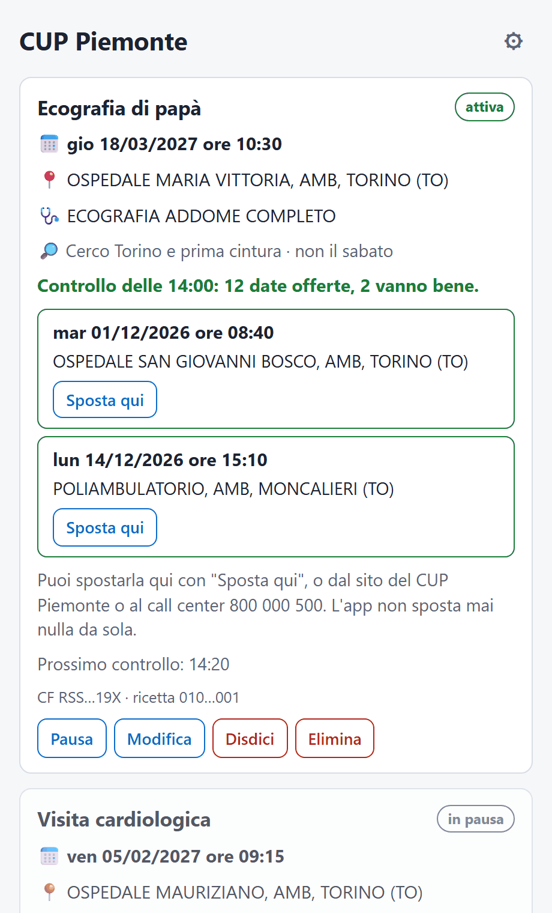

# App desktop CUP Piemonte

**[Scarica l'app](https://ilmondovero.github.io/cup-piemonte-checker/)** per Windows, macOS e Linux
(versione 0.3.1, di prova). Link diretti e avvisi del primo avvio: [Installarla](#installarla).



Un'app leggera per Windows, macOS e Linux che controlla il portale [CUP Piemonte](https://cup.isan.csi.it/)
dal tuo computer. È un progetto separato dal bot Telegram della cartella [`../telegram-bot/`](../telegram-bot/):
non usa Telegram né un server e non condivide codice con il bot. Del bot riprende le regole sul
comportamento del portale, che lì sono già state verificate.

## A che punto è

| Passo | Cosa | Stato |
|---|---|---|
| 1 | Motore: legge la prenotazione attuale (codice fiscale + numero ricetta) | ✅ fatto |
| 2 | Ricerca delle date alternative (zona, giorni da evitare), senza spostare nulla | ✅ fatto |
| 3 | Ricette salvate e cifrate, controlli ogni 20 minuti, notifiche, icona nella barra di sistema | ✅ fatto |
| 4 | Spostamento e disdetta, solo quando lo chiedi tu | ✅ fatto |
| 5 | Installer per i tre sistemi (GitHub Actions) | ✅ fatto |
| 6 | Ricette mai prenotate: cerca il primo posto libero e prenota, solo quando lo chiedi tu | ✅ fatto (0.2.0, sperimentale) |
| 7 | Aggiornamenti automatici, firmati, mai durante un'operazione | ✅ fatto (0.3.0) |

**Come si usa.** Si aggiunge una ricetta con nome, codice fiscale e numero ricetta, la zona e i giorni da
evitare. L'app legge la prenotazione (solo lettura; se non c'è, la ricetta da prenotare) e poi, se la ricetta è attiva, la controlla da sola ogni
20 minuti. Quando esce una data che va bene arriva una notifica del sistema con data, ora e luogo, una
volta sola per data. Chiudendo la finestra l'app resta nella barra di sistema e continua; si esce dal menu
dell'icona. Nelle impostazioni si può farla partire con il computer.

**Controlli.** Ogni controllo apre "Sposta appuntamento" per vedere le date (per una ricetta mai prenotata, la
pagina degli appuntamenti di una prenotazione nuova), come il bot: la data proposta
dal portale resta bloccata a quella sessione per circa 40 minuti, e non c'è modo di rilasciarla. Per questo
ogni ricetta si controlla al massimo una volta ogni 20 minuti, anche dopo un riavvio o se la si elimina e la
si aggiunge di nuovo, e l'app non si apre due volte. Se la stessa visita risulta prenotata due volte, l'app
non apre "Sposta", mette in pausa e dice quale delle due disdire. Mette in pausa anche se la prenotazione è
disdetta o erogata, o se il portale non la trova per tre controlli di fila. Se segui la stessa ricetta anche
con il bot, usa uno solo dei due.

**Spostare e disdire.** L'app non sposta mai nulla da sola. Su ogni data trovata c'è "Sposta qui", e sulla
scheda "Disdici": entrambi chiedono conferma mostrando data, ora e luogo. Lo spostamento segue il bot passo
per passo:
- riusa la sessione del controllo che ha trovato la data, che tiene bloccata la proposta, se ha meno di
  35 minuti; altrimenti ne apre una nuova;
- prima di confermare rilegge la prenotazione e controlla che la data vada ancora bene (zona, giorni,
  prima della prenotazione);
- controlla che il Riepilogo riporti la stessa data, lo stesso luogo e la stessa prestazione. Se più
  prestazioni sono prenotate insieme, si spostano tutte o nessuna;
- se il Riepilogo ha delle note, fa la presa visione; le note (per esempio la preparazione all'esame)
  restano nell'app;
- dopo la Conferma rilegge l'elenco con sessioni nuove, fino a 3 minuti, per verificare che sia andata.

La disdetta preme "Disdici" sulla riga giusta e "Sì" nel dialogo, poi verifica allo stesso modo.

Prima della Conferma l'app salva sul disco che l'operazione sta partendo; se non ci riesce, non conferma.
Se dopo la Conferma non riesce a verificare l'esito, o se si chiude a metà, lo dice con una notifica. In quel
caso mette la ricetta in pausa e non fa altre operazioni finché non tocchi "Ho controllato" dopo aver
guardato sul sito del CUP. Su una ricetta si fa una cosa alla volta: mai uno spostamento durante un
controllo.

**Ricette mai prenotate** (dalla versione 0.2.0, sperimentale). Se il portale non trova prenotazioni per la
ricetta, o le ha tutte disdette, l'app la segue come "mai prenotata":
- per aggiungerla fa solo il passo "Ricerca" del portale (codice fiscale e ricetta), che non blocca date, e
  ne legge le prestazioni;
- ogni controllo fa "Ricerca", poi "Avanti" sul passo "Prestazioni" lasciando le prestazioni come le propone
  il portale, poi legge le date come per uno spostamento. Va bene ogni data nella zona e in un giorno sì;
- senza una prenotazione non c'è un comune, una provincia o una sede "della prenotazione": finché la ricetta
  non è prenotata queste zone valgono come "dove propone il CUP", poi torna a valere la scelta. Per un comune
  preciso fin da subito si sceglie "In un altro comune…";
- con più prestazioni nella stessa ricetta si prenota solo la data che il portale propone per tutte insieme;
- "Prenota qui" chiede conferma con data, ora e luogo. Prima di confermare l'app rilegge l'elenco (due volte,
  perché il portale a volte non trova prenotazioni che ci sono): se nel frattempo la ricetta risulta
  prenotata, non prenota e da lì cerca date prima di quella prenotazione (lo stesso se un controllo la trova
  prenotata, per esempio dal sito del CUP: lo dice con data, ora e luogo). Il Riepilogo deve riportare la
  data, il luogo e tutte le prestazioni del carrello in un solo appuntamento;
- dopo la Conferma verifica come per uno spostamento; da lì la ricetta è prenotata e l'app cerca date prima.

Il passo "Prestazioni" non è ancora stato visto con una ricetta vera (come per il bot). Se l'app non lo
riconosce si ferma, non prenota, e nel registro scrive com'è fatta la pagina: solo nomi di sezioni e
pulsanti, mai dati personali. Un passo che il portale salta, invece, non dà problemi.

**Zone e giorni.** Le stesse del bot: solo la sede, il comune della prenotazione o un altro, più comuni,
Torino e prima cintura, la provincia o dove propone il CUP. Per comune, comuni e provincia l'app preme
"Estendi area di ricerca", così compaiono anche le aziende sanitarie più lontane. I comuni del Piemonte
sono in `core/data/comuni_piemonte.txt` (ISTAT). Una data va bene se è nella zona, non cade in un giorno
da evitare ed è prima della prenotazione.

## Installarla

La [pagina di download](https://ilmondovero.github.io/cup-piemonte-checker/) propone il file giusto per
il tuo sistema. Tutte le versioni sono nella pagina [Releases](https://github.com/ilmondovero/cup-piemonte-checker/releases)
("App desktop X.Y.Z"). I file della versione 0.3.1:

- **Windows**: [`CUP-Piemonte_0.3.1_x64-setup.exe`](https://github.com/ilmondovero/cup-piemonte-checker/releases/download/app-v0.3.1/CUP-Piemonte_0.3.1_x64-setup.exe), che installa per il solo utente e non chiede i permessi di
  amministratore; il [`.msi`](https://github.com/ilmondovero/cup-piemonte-checker/releases/download/app-v0.3.1/CUP-Piemonte_0.3.1_x64.msi) installa per tutti gli utenti. Se manca WebView2 lo scarica l'installer.
- **macOS** (Intel e Apple Silicon): [`CUP-Piemonte_0.3.1_universal.dmg`](https://github.com/ilmondovero/cup-piemonte-checker/releases/download/app-v0.3.1/CUP-Piemonte_0.3.1_universal.dmg); si trascina l'app in Applicazioni.
- **Linux**: [`.deb`](https://github.com/ilmondovero/cup-piemonte-checker/releases/download/app-v0.3.1/CUP-Piemonte_0.3.1_amd64.deb) (Ubuntu 22.04+, Debian 12+, Mint 21+), [`.rpm`](https://github.com/ilmondovero/cup-piemonte-checker/releases/download/app-v0.3.1/CUP-Piemonte-0.3.1-1.x86_64.rpm)
  (Fedora, openSUSE) oppure [`.AppImage`](https://github.com/ilmondovero/cup-piemonte-checker/releases/download/app-v0.3.1/CUP-Piemonte_0.3.1_amd64.AppImage) (le altre; va resa
  eseguibile con `chmod +x`).

[`SHA256SUMS.txt`](https://github.com/ilmondovero/cup-piemonte-checker/releases/download/app-v0.3.1/SHA256SUMS.txt) contiene le somme SHA-256 dei file, per controllare che il download sia integro
(`sha256sum -c SHA256SUMS.txt --ignore-missing` su Linux, `shasum -a 256 -c SHA256SUMS.txt --ignore-missing`
su macOS, `Get-FileHash .\nome-del-file -Algorithm SHA256` in PowerShell su Windows).

Gli installer non sono firmati con un certificato, perché costa e richiede un'identità registrata. Per
questo la prima volta il sistema avvisa:

- **Windows** (SmartScreen, "Windows ha protetto il PC"): "Ulteriori informazioni", poi "Esegui comunque".
- **macOS** ("non può essere aperta" o "è danneggiata"): prova ad aprirla una volta, poi in Impostazioni di
  Sistema > Privacy e sicurezza (fino a macOS 12: Preferenze di Sistema > Sicurezza e privacy) "Apri comunque". Se il pulsante non c'è, da Terminale:
  `xattr -dr com.apple.quarantine "/Applications/CUP Piemonte.app"`.

Gli installer li costruisce GitHub Actions a partire dal codice di questo repository
([`.github/workflows/app-installer.yml`](../.github/workflows/app-installer.yml)): prima girano i test sui
tre sistemi, poi ogni installer si installa e si avvia su una macchina pulita di GitHub; solo se l'app
parte senza errori finisce nella release. Un tag `app-vX.Y.Z` crea la release in bozza, che si pubblica a
mano dopo averla provata.

## Aggiornamenti

Dalla versione 0.3.0 l'app si aggiorna da sola. Chi ha la 0.1.0 o la 0.2.0 installa una volta la 0.3.0 sopra la
vecchia (le ricette restano); da lì in poi non serve più.

- **Quando.** Qualche minuto dopo l'avvio e poi ogni 6 ore l'app guarda se c'è una versione nuova. Una
  versione nuova si installa da sola **48 ore dopo la pubblicazione**: se si rivela difettosa la si ritira
  prima che arrivi a tutti; subito prima di installarla l'app ricontrolla il canale, quindi una versione
  ritirata non arriva. Per averla subito: ⚙, poi "Aggiorna alla X.Y.Z".
- **Mai durante un'operazione.** L'installazione aspetta che non ci siano controlli, spostamenti,
  prenotazioni o disdette in corso, e finché dura non ne parte nessuno. Su Windows l'app si chiude, compare
  per qualche secondo la barra dell'installazione e l'app si riapre da sola; su macOS e Linux si riavvia.
  Dopo un aggiornamento arriva una notifica con la versione.
- **Firmati.** Ogni pacchetto è firmato, e la firma comprende la versione: l'app installa solo pacchetti
  firmati con la chiave che ha dentro, e mai una versione più vecchia di quella che ha.
- **Le ricette al sicuro.** Prima di installare, l'app copia il file delle ricette, cifrato come
  l'originale, nella sottocartella `copie` della cartella dei dati (le ultime 5). Se una versione nuova non
  riuscisse a leggerle: chiudere l'app, rimettere la copia al posto di `ricette.cifrate`, riaprire.
- **Se non va.** Al riavvio l'app controlla di essere davvero la versione nuova. Un'installazione non
  riuscita si riprova dopo un'ora; dopo due volte l'app smette di riprovarla da sola, lo dice con una
  notifica e continua con la versione che ha. Su Windows, se l'installazione si interrompe a metà, l'app
  resta chiusa: si riapre dal menu Start, o da sola al prossimo accesso se parte con il computer.
- **Una versione difettosa si corregge da lontano.** Se l'app non riesce più ad aprire le ricette, mentre
  mostra l'errore cerca una versione nuova e la installa: subito se la versione rotta si è appena installata o se
  la correzione è segnata urgente, altrimenti con le solite 48 ore.
- **Da sola solo dove non serve una password**: installer `.exe`, app per macOS, `.AppImage`, quando la
  cartella dell'app si può scrivere. Con il `.msi`, il `.deb`, il `.rpm` o un'app per macOS installata da un
  amministratore il sistema chiede la password: l'app avvisa con una notifica e installa solo quando tocchi
  "Aggiorna" nelle impostazioni.
- Gli aggiornamenti automatici si spengono nelle impostazioni (⚙): l'app continua ad avvisare.

Le versioni nuove l'app le legge da due posti indipendenti, entrambi su GitHub: il file `latest.json` della
release [`aggiornamenti`](https://github.com/ilmondovero/cup-piemonte-checker/releases/tag/aggiornamenti) e la
stessa copia su GitHub Pages. In quelle richieste non c'è nessun dato delle ricette: GitHub vede solo
l'indirizzo IP e la versione dell'app, come per qualsiasi download.

I controlli girano solo con il computer acceso e non in sospensione. Su Linux con GNOME (Fedora, Debian)
l'icona nella barra compare solo con l'estensione "AppIndicator and KStatusNotifierItem Support"; senza,
la finestra si riapre lanciando di nuovo l'app e si chiude del tutto con `pkill -x cup-piemonte`.

**Disinstallare e cancellare i dati.** Prima, nell'app, eliminare le ricette e spegnere l'avvio con il
computer; poi disinstallare come le altre app. Ricette cifrate (`ricette.cifrate`, ed eventualmente
`chiave.segreta`) e registro restano nelle cartelle dell'app, da cancellare a mano:
- Windows: `%APPDATA%\io.github.ilmondovero.cup` e `%LOCALAPPDATA%\io.github.ilmondovero.cup`;
- macOS: `~/Library/Application Support/io.github.ilmondovero.cup` e `~/Library/Logs/io.github.ilmondovero.cup`;
- Linux: `~/.local/share/io.github.ilmondovero.cup`.

La chiave sta nel portachiavi del sistema alla voce `cup-piemonte`, utente `chiave-archivio`.

**Problemi.** Nelle [Issues](https://github.com/ilmondovero/cup-piemonte-checker/issues/new/choose): la
pagina è pubblica, quindi mai codice fiscale, numero ricetta o dati della visita. Le righe del registro
si possono incollare (non contengono questi dati), dopo averle rilette.

## Com'è fatta

- `core/`: il motore in Rust. Fa le richieste HTTP al portale (JSF/ICEfaces, campo per campo come il
  browser) e legge le pagine. Non ha dipendenze dall'interfaccia.
- `cli/`: il comando `cup` per provare il motore da terminale.
- `desktop/`: l'app [Tauri 2](https://tauri.app/). Usa il browser del sistema (WebView2, WebKit), non
  porta con sé Chromium. `archivio.rs` salva le ricette, `controlli.rs` fa i controlli in un thread a parte,
  `operazioni.rs` sposta e disdice (il percorso sul portale è in `core/src/operazioni.rs`),
  `aggiornamenti.rs` controlla e installa le versioni nuove, `segnalazioni.rs` manda le segnalazioni dei
  problemi (se accese).

## Provarla

Serve [Rust](https://rustup.rs/). Su Linux servono anche le librerie di WebKitGTK
(vedi i [prerequisiti di Tauri](https://tauri.app/start/prerequisites/)).

```sh
cd app
cargo test -p cup-core                      # test del motore, senza rete
cargo run -p cup-cli -- attuale             # chiede codice fiscale e numero ricetta
cargo run -p cup-cli -- cerca --dove cintura --evita ven   # date prima, chiede conferma
cargo run -p cup-desktop                    # apre la finestra
```

Il comando `cup` legge codice fiscale e numero ricetta da `CUP_CF` e `CUP_NRE` oppure li chiede. Non li
accetta come argomenti, perché resterebbero nella cronologia dei comandi.

## Contatti per il CUP

Ogni ricetta può avere un'email e un cellulare, facoltativi ("Aggiungi ricetta" e "Modifica"; "Usa gli stessi
contatti" copia quelli di un'altra ricetta). Quando l'app sposta o prenota, li scrive nel Riepilogo del portale:
l'email nel suo campo, il cellulare nel primo numero che si può cambiare (di solito il terzo; i primi due vengono
dall'anagrafe sanitaria e il portale non li fa cambiare: restano come sono). Il CUP manda lì
la conferma, il promemoria e gli SMS. Il cellulare deve essere italiano (comincia con 3); spazi, trattini e +39 si
tolgono da soli. Se il portale rifiuta i contatti (un suo messaggio d'errore sul campo dell'email o del telefono,
o che parla proprio di email, telefono o recapito, non del call center), l'app conferma una volta sola senza, con
i recapiti che il Riepilogo aveva già: la prenotazione non si perde. Dopo una prenotazione o uno spostamento
riusciti l'app dice dove arriva la conferma, nominando solo i contatti che sono andati davvero nel Riepilogo.

## Registro

L'app scrive in un file di testo cosa fa e quando: avvio, controlli con quante date ha trovato e quanto sono
durati, errori del portale, pause, spostamenti e disdette (riusciti, fermati o incerti), notifiche. Le ricette compaiono con il loro numero nell'app ("ricetta 2"):
nel registro non ci sono codice fiscale, numero ricetta, prestazione né date della visita. Si legge dalle
impostazioni (Registro dell'app), dove c'è anche il percorso del file. Il file ruota oltre i 512 KB.

Non c'è telemetria. L'app fa le richieste al portale CUP e, ogni 6 ore, legge da GitHub se c'è una versione
nuova (vedi [Aggiornamenti](#aggiornamenti)). Manda qualcosa allo sviluppatore solo se accendi le
[segnalazioni dei problemi](#segnalazioni-dei-problemi), che all'inizio sono spente.

## Segnalazioni dei problemi

Nelle impostazioni (⚙) c'è "Invia allo sviluppatore le segnalazioni dei problemi", spenta all'inizio. Accesa,
l'app manda una segnalazione quando succede qualcosa di serio: un errore interno (mandato all'avvio dopo), un
avvio non riuscito, un aggiornamento che non si installa, una pagina del portale che non riconosce per due
controlli di fila, un esito incerto dopo una conferma o una disdetta. Arriva allo sviluppatore su Telegram,
passando dal server del bot.

Dentro ci sono versione, sistema, tipo di installazione, che cosa è successo (una frase scritta dall'app) e le
ultime 80 righe del registro, con i secondi trascorsi al posto di data e ora; per un errore interno anche il
punto del codice (file e riga), mai il messaggio né la pila. Nomi, prestazioni e luoghi non ci sono perché il
registro non li scrive mai (l'app non saprebbe riconoscerli in un testo). Prima di partire l'app toglie anche
codici fiscali, numeri di ricetta, date, orari, email, telefoni e i percorsi della cartella dell'utente. C'è anche un
numero a caso scelto la prima volta (16 cifre esadecimali), che non dice nulla di te o del computer: serve solo
a capire se più segnalazioni vengono dalla stessa installazione.

Al massimo una segnalazione dello stesso tipo ogni 6 ore e 10 al giorno, 5 in attesa (con la coda piena si
butta la più vecchia); anche il server ha i suoi limiti. Si mandano in un thread a parte e non fermano mai
controlli, spostamenti o aggiornamenti. Senza rete si riprova all'avvio dopo, al massimo 3 volte.
L'indirizzo del server (solo https) entra nell'app quando si compila (`CUP_SEGNALAZIONI_URL`, un segreto del
repository): non è nel codice pubblico, ma è dentro l'app installata, e chi la smonta lo trova. Una copia
compilata senza non ha l'opzione e non manda mai nulla. Nel registro resta una riga per ogni
segnalazione inviata o scartata, senza il contenuto.

## Privacy

Codice fiscale e numero ricetta vanno solo al portale CUP. Sul computer le ricette stanno in un file
cifrato (XChaCha20-Poly1305) nella cartella dei dati dell'app, con la chiave nel portachiavi del sistema
(Gestione credenziali di Windows, Portachiavi di macOS, Secret Service su Linux). Se il portachiavi non
c'è, la chiave sta in un file leggibile solo dall'utente, e l'app lo dice nelle impostazioni.
Nell'interfaccia codice fiscale e ricetta compaiono solo in parte (RSS…19X). Con "Copia" accanto a ciascuno
l'app li mette interi negli appunti, per cercare la ricetta sul sito del CUP: su Windows fuori dalla cronologia
degli appunti (Win+V) e dalla sincronizzazione, e dopo 2 minuti, o alla chiusura dell'app, gli appunti si
svuotano se contengono ancora quello.
Email e cellulare di una ricetta, se li scrivi, stanno nello stesso file cifrato, vanno solo al portale CUP
(nel Riepilogo, quando sposti o prenoti con l'app) e nella scheda si vedono mascherati (m\*\*\*@gmail.com,
\*\*\* \*\*\* 4567, solo le ultime 4 cifre). Non finiscono mai nel registro: lì c'è solo se ci sono ("contatti: email si/no, cellulare
si/no").
Allo sviluppatore non arriva nulla, a meno che tu non accenda le
[segnalazioni dei problemi](#segnalazioni-dei-problemi). Anche allora codice fiscale, numero ricetta, nomi e
luoghi restano fuori perché il registro non li scrive mai, e prima di mandare l'app toglie comunque codici
fiscali, numeri di ricetta, date, orari, email, telefoni e percorsi delle cartelle.

## Pubblicare una versione nuova

1. Alzare la versione in `desktop/tauri.conf.json` e in `Cargo.toml` (`workspace.package`), poi
   `cargo build` per aggiornare `Cargo.lock`. Il workflow controlla che le due versioni coincidano.
2. Commit, poi il tag: `git tag -a app-vX.Y.Z -m "App desktop X.Y.Z" && git push origin app-vX.Y.Z`.
3. Il workflow prova e carica tutto in una release in **bozza**, con le note generate da
   `.github/scripts/note-release.sh`. La si controlla e la si pubblica dalla pagina Releases, come
   versione di prova (pre-release) o stabile.
   Se è una correzione urgente, scrivere `<!-- urgente -->` nelle note prima di pubblicarla: le app la
   installano subito, senza il rodaggio di 48 ore.
4. Alla pubblicazione parte da solo
   [`app-aggiornamenti.yml`](../.github/workflows/app-aggiornamenti.yml): scarica i pacchetti, ne verifica le
   firme, scrive `latest.json` nella release `aggiornamenti` e in `docs/aggiornamenti/` (commit su master) e lo
   rilegge da entrambi. Da quel momento le app installate vedono la versione nuova.
   **Ritirarla** durante le 48 ore: avviare a mano quel workflow con il tag della versione precedente. Chi non
   l'ha ancora installata resta dov'è; chi l'ha già presa (con "Aggiorna") aspetta la correzione, perché l'app
   non torna mai a una versione più vecchia.
5. **Solo dopo la pubblicazione** (prima i file non esistono e i link darebbero 404) aggiornare i link
   diretti con la versione nuova: `README.md` (in cima), la sezione [Installarla](#installarla) qui sopra,
   la riga in cima a questo file e in `docs/index.html` gli `href` dei file, `RISERVA` e la versione
   mostrata. La pagina di download trova comunque da sola l'ultima versione; i link scritti servono
   senza JavaScript o se GitHub non risponde.

**La chiave che firma gli aggiornamenti.** La chiave privata è nel segreto `TAURI_SIGNING_PRIVATE_KEY` del
repository (senza password) e, fuori dal repository, sul computer di chi pubblica, con una copia di sicurezza.
La chiave pubblica è in `desktop/tauri.conf.json` (`plugins > updater > pubkey`) ed è scritta dentro ogni app
installata. Se la chiave privata si perde, le app installate non accettano più nessun aggiornamento e
bisogna reinstallarle a mano; per questo il workflow verifica ogni firma con la chiave pubblica prima di creare
la bozza.

## Licenza

[MIT](LICENSE). Progetto indipendente, non ufficiale: non è collegato alla Regione Piemonte né al CSI
Piemonte.
